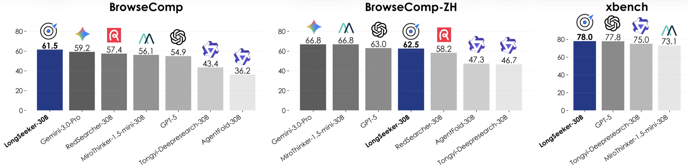

# LongSeeker: Elastic Context Orchestration for Long-Horizon Search Agents

<div align="center">
  <a href="https://github.com/PolarSeeker/LongSeeker">
    
  </a>
  <a href="https://arxiv.org/abs/2605.05191">
    
  </a>
  <a href="https://huggingface.co/PolarSeeker/LongSeeker-30B-SFT">
    
  </a>
</div>

<div align="center">
  
</div>

**LongSeeker** is a long-horizon search agent that introduces **Context-ReAct**, a paradigm for elastic context orchestration. Unlike standard ReAct agents that passively accumulate observations, LongSeeker dynamically reshapes its working context using five atomic meta-operations: **Skip**, **Compress**, **Rollback**, **Snippet**, and **Delete**. This allows the agent to preserve critical evidence, summarize resolved information, discard unhelpful branches, and control context size—achieving reliable and efficient long-horizon reasoning.

## Highlights

- **Strong long-horizon search performance**: LongSeeker achieves **61.5** on BrowseComp, **62.5** on BrowseComp-ZH, **78.0** on xbench-2505, and **77.7** on GAIA-text, demonstrating competitive capability across both web search and general agent benchmarks.
- **Elastic context orchestration for search agents**: We introduce **Context-ReAct**, a new agentic paradigm that jointly generates reasoning, context meta-operations, and tool calls, enabling agents to dynamically decide **when, where, and how** to reshape their working context during long-horizon search.
- **Comprehensive and fine-grained context control**: Context-ReAct defines five atomic operations—**Skip, Compress, Rollback, Snippet, and Delete**—forming an expressively complete yet efficient operation set for multi-resolution context management.
- **Efficient context management at extended horizons**: LongSeeker maintains a stable working context of around **15k tokens** even across long trajectories, using only a small fraction of its **256k** context window while avoiding the rapid context growth of standard ReAct agents.

## Overview

This repository provides the **inference and evaluation code** for LongSeeker. The agent runs in a **separate-turn** setting: each step, the model produces motivation, optional meta-tool calls for context management, and a standard tool call (`search_web` or `visit_web`). Trajectories are saved as JSON and can be scored with the included evaluator.

The codebase is designed to be configuration-driven. All API keys and model endpoints are read from `config/.env`—nothing sensitive is hard-coded in the source.

---

## Quick Start

### 1. Installation

```bash
# Clone repository
git clone https://github.com/PolarSeeker/LongSeeker.git
cd LongSeeker

# Create conda environment
conda create --name longseeker python=3.10
conda activate longseeker
pip install -r requirements.txt
```

### 2. Configure Environment

Fill in `config/.env` with your API keys and model endpoints:

```bash
# Main reasoning LLM (Context-ReAct agent)
LLM_API_KEY=
LLM_BASE_URL=
LLM_MODEL=

# Summary LLM used by visit_web to extract evidence from page content
SUMMARY_API_KEY=
SUMMARY_BASE_URL=
SUMMARY_MODEL_NAME=

# External tool APIs
SERPER_API_KEY=
JINA_API_KEY=
```


| Variable             | Used by                     | Description                                                         |
| -------------------- | --------------------------- | ------------------------------------------------------------------- |
| `LLM_API_KEY`        | `main_separate.py`          | API key for the main agent LLM                                      |
| `LLM_BASE_URL`       | `main_separate.py`          | OpenAI-compatible base URL for the main agent                       |
| `LLM_MODEL`          | `main_separate.py`          | Model name for the main agent                                       |
| `SUMMARY_API_KEY`    | `tools/utils.py`, `eval.py` | API key for the summary / judge LLM                                 |
| `SUMMARY_BASE_URL`   | `tools/utils.py`, `eval.py` | Base URL for the summary / judge LLM                                |
| `SUMMARY_MODEL_NAME` | `tools/utils.py`, `eval.py` | Model name for summarization and answer judging                     |
| `SERPER_API_KEY`     | `tools/tool/search_web.py`  | [Serper](https://serper.dev/) API key for Google search             |
| `JINA_API_KEY`       | `tools/tool/visit_web.py`   | [Jina Reader](https://jina.ai/reader/) API key for webpage fetching |


Both `main_separate.py` and `eval.py` automatically load `config/.env` at startup.

### 3. Prepare Dataset

Place your benchmark file under `dataset/`. Each item must be a JSON object with:

```json
[
  {
    "id": "1",
    "query": "Your question here.",
    "gt": "Ground truth answer."
  }
]
```

### 4. Run Inference

The recommended entry point is `run_separate.sh`:

```bash
bash run_separate.sh
```

Or invoke `main_separate.py` directly:

```bash
python -u main_separate.py \
    --dataset dataset/browsecomp.json \
    --tool_count_max 300 \
    --num_workers 30 \
    --use_meta_tools true
```

**Useful flags**


| Flag                 | Default                         | Description                                                 |
| -------------------- | ------------------------------- | ----------------------------------------------------------- |
| `--dataset`          | `dataset/browsecomp_test1.json` | Path to input JSON                                          |
| `--tool_count_max`   | `30`                            | Maximum agent steps per question                            |
| `--num_workers`      | `1`                             | Concurrent items                                            |
| `--use_meta_tools`   | `true`                          | Enable Context-ReAct meta tools                             |
| `--item_ids`         | `None`                          | Run only specific IDs, e.g. `--item_ids 1 2 3`              |
| `--resume_from_step` | `None`                          | Resume from step N (0-based); writes to a `_resumed` folder |


**Disable meta tools (standard ReAct baseline)**

```bash
USE_META_TOOLS=false bash run_separate.sh
```

Or:

```bash
python -u main_separate.py \
    --dataset dataset/browsecomp.json \
    --use_meta_tools false
```

### 5. Evaluate Results

After inference, run the LLM-as-judge evaluator:

```bash
bash eval.sh
```

Or:

```bash
python -u eval.py \
    --result_dir result/browsecomp_meta_react_separate \
    --dataset_path dataset/browsecomp.json \
    --num_workers 10 \
    --skip_existing true
```

The evaluator:

1. Reads each `result_{id}.json`
2. Extracts the final `<answer>...</answer>` from the trajectory
3. Uses the summary LLM (`SUMMARY_*` in `.env`) to judge correctness against `gt`
4. Writes `eval_results.json` into the result directory

**Evaluator flags**


| Flag              | Default                                 | Description                             |
| ----------------- | --------------------------------------- | --------------------------------------- |
| `--result_dir`    | `result/browsecomp_meta_react_separate` | Folder with `result_*.json`             |
| `--dataset_path`  | `dataset/browsecomp.json`               | Dataset with ground truth               |
| `--num_workers`   | `10`                                    | Concurrent judge calls                  |
| `--skip_existing` | `true`                                  | Skip IDs already in `eval_results.json` |
| `--item_id`       | `None`                                  | Evaluate a single item only             |


---

## How It Works

### Context-ReAct Loop

Each step in `main_separate.py` follows this loop:

1. Build a user prompt from the question, tool schemas, and current context (`context.py`).
2. Call the main LLM (`LLM_`* env vars).
3. Parse `<motivation>`, optional `<meta_tool_call>`, and `<standard_tool_call>` from the response.
4. Apply meta tools to reshape context (if enabled).
5. Execute `search_web` or `visit_web`.
6. Append the new step to context and trajectory.

On the final allowed step, the agent uses a shorter prompt (`tool_user_prompt_last`) and is asked to produce a final answer.

### Meta Tools


| Tool         | Purpose                                              |
| ------------ | ---------------------------------------------------- |
| **Skip**     | Default no-op; keep context unchanged                |
| **Compress** | Merge a step range into one summarized block         |
| **Rollback** | Remove a step and everything after it                |
| **Snippet**  | Keep only selected prefix/suffix of a step's content |
| **Delete**   | Remove a specific step block                         |


Implementation: `tools/meta_tool/`. Context state: `context.py`.

### Standard Tools


| Tool         | Purpose                                          | Backend                     |
| ------------ | ------------------------------------------------ | --------------------------- |
| `search_web` | Google search via Serper                         | `SERPER_API_KEY`            |
| `visit_web`  | Fetch page with Jina, summarize with summary LLM | `JINA_API_KEY`, `SUMMARY_`* |


---

## Project Structure

```text
LongSeeker/
├── assets/                      # Figures and paper PDF
│   ├── teasor.png               # Overview figure
│   └── LongSeeker.pdf           # Paper PDF
├── config/
│   └── .env                     # API keys and model endpoints (fill locally)
├── dataset/                     # Benchmark JSON files (user-provided)
├── prompts/                     # Prompt templates
│   └── prompt.py                # Default Context-ReAct prompt (used in paper)
├── result/                      # Inference outputs (created at runtime)
│   └── {dataset}_meta_react_separate/
│       ├── result_{id}.json     # Per-item trajectory
│       ├── logs/{id}.log        # Per-item log
│       └── eval_results.json    # Evaluation output (after eval.py)
├── tools/
│   ├── utils.py                 # Summary LLM client (`call_server`)
│   ├── tool/
│   │   ├── search_web.py        # Serper search tool
│   │   └── visit_web.py         # Jina fetch + summary extraction
│   └── meta_tool/
│       ├── skip.py
│       ├── compress.py
│       ├── rollback.py
│       ├── snippet.py
│       └── delete.py
├── context.py                   # Context manager for Previous Steps
├── resume_context.py            # Restore context when resuming a run
├── main_separate.py             # Main inference entry point
├── run_separate.sh              # Shell wrapper for inference
├── eval.py                      # LLM-as-judge evaluation
├── eval.sh                      # Shell wrapper for evaluation
├── requirements.txt
└── README.md
```

### Key Files


| File                | Role                                                                |
| ------------------- | ------------------------------------------------------------------- |
| `main_separate.py`  | Loads `.env`, runs async multi-worker inference, saves trajectories |
| `context.py`        | Maintains step blocks shown in `### Previous Steps`                 |
| `prompts/prompt.py` | System/user prompts for Context-ReAct and final-answer turn         |
| `tools/utils.py`    | OpenAI-compatible client for page summarization and eval judging    |
| `eval.py`           | Accuracy, average steps, token/cost summary                         |


### Trajectory Format

Each `result_{id}.json` is a JSON list. Typical step entry:

```json
{
  "user_prompt": "...",
  "reasoning": "...",
  "response": "..."
}
```

---

## Citation

If you find LongSeeker useful in your research, please consider citing:

```bibtex
@article{lu2026longseeker,
  title={LongSeeker: Elastic Context Orchestration for Long-Horizon Search Agents},
  author={Lu, Yijun and Ye, Rui and Du, Yuwen and Wang, Jiajun and Liu, Songhua and Chen, Siheng},
  journal={arXiv preprint arXiv:2605.05191},
  year={2026}
}
```

Paper: [arXiv:2605.05191](https://arxiv.org/abs/2605.05191)

Model: [LongSeeker-30B-SFT](https://huggingface.co/PolarSeeker/LongSeeker-30B-SFT)